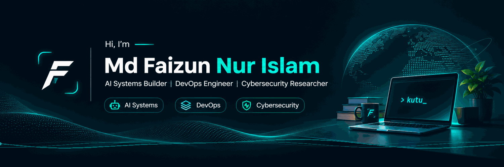

### Building Intelligent Systems. Engineering the Infrastructure Behind Them.

  
  
  

---

## 👋 About Me

I'm **Md Faizun Nur Islam**, a Software Engineering student at **Daffodil International University, Bangladesh**.

I'm passionate about building intelligent software systems and understanding the infrastructure that makes them reliable, scalable, and secure.

My engineering interests sit at the intersection of three domains:

- 🤖 **AI Systems Engineering** — Multi-agent architectures, LLM integrations, intelligent automation, and AI orchestration.
- ⚙️ **DevOps & Cloud Engineering** — Kubernetes, CI/CD, infrastructure automation, cloud-native architecture, and GitOps.
- 🔐 **Cybersecurity** — Application security, network security, threat modeling, and security research.

I believe the best way to understand technology is to build with it, experiment, investigate failures, and continuously improve the architecture.

## 🚀 What I'm Building

### Kutu — AI Agent Control Plane

An AI control platform designed to bring multiple AI assistants into one coordinated environment.

Instead of manually switching between AI platforms, users can delegate complex tasks to multiple agents, coordinate their work, and receive consolidated results.

**Core Features & Interests**

- Multi-agent task distribution and orchestration.
- Intelligent task decomposition.
- Agent coordination and result aggregation.
- Human-in-the-loop approvals.
- Centralized management of AI workers.
- Efficient execution with reduced duplicated work.

### PipelineHealer — AI-Powered DevOps Automation

Exploring how AI can make software delivery pipelines more intelligent.

PipelineHealer focuses on analyzing CI/CD failures, identifying possible causes, suggesting fixes, and allowing engineers to review proposed changes before applying them.

[Explore PipelineHealer →](https://github.com/faizunnur/PipelineHealer)

---

## 🧩 Featured Projects

<table>
<tr>
<td width="50%" valign="top">

### 🤖 AI Control Plane

Centralized orchestration of AI assistants and agents, bringing task execution, approvals, and agent management into one workspace.

**Focus:** AI Orchestration · Multi-Agent Systems

[View Repository →](https://github.com/faizunnur/aicontrolplane)

</td>
<td width="50%" valign="top">

### ⚙️ PipelineHealer

AI-assisted CI/CD failure analysis and remediation with an approval-based workflow.

**Focus:** AI · DevOps · Automation

[View Repository →](https://github.com/faizunnur/PipelineHealer)

</td>
</tr>

<tr>
<td width="50%" valign="top">

### 🔐 CyberConnect-DIU

A cybersecurity-focused platform being developed for the DIU community.

**Focus:** Cybersecurity · Community · Web Development

[View Repository →](https://github.com/faizunnur/CyberConnect-DIU)

</td>
<td width="50%" valign="top">

### 📝 OBE Assistant

An automated assessment system using OCR and machine learning to extract and evaluate handwritten answers.

**Focus:** Python · CRNN · CNN · Tesseract · Flutter

</td>
</tr>

<tr>
<td width="50%" valign="top">

### 👁️ Face Recognition Attendance

A computer vision-based attendance management system using facial recognition.

**Focus:** Python · OpenCV · Face Recognition

</td>
<td width="50%" valign="top">

### 🌐 Social Media Scheduler

A full-stack project focused on scheduling and managing social media content.

[View Repository →](https://github.com/faizunnur/social-media-scheduler)

</td>
</tr>
</table>

---

## 🛠️ Technology Stack

### Languages & Software Development

### AI & Machine Learning

- Large Language Model integration
- Multi-agent systems
- Computer vision
- OCR and document processing
- AI-powered automation

### DevOps, Cloud & Infrastructure

- Containerization and orchestration
- CI/CD pipeline engineering
- Infrastructure as Code
- GitOps and deployment automation
- Cloud-native architecture

### Cybersecurity

- Web application security
- Network security and reconnaissance
- Threat modeling and security architecture
- DevSecOps
- Secure software development

### Databases

---

## 🔬 Research Interests

I'm particularly interested in:

- Threat modeling and defensive frameworks for authentication systems.
- Security challenges in mobile financial services.
- Phishing detection and mobile security.
- AI-assisted cybersecurity analysis.
- Secure and reliable AI agent architectures.

My long-term goal is to contribute to meaningful research and publish work in cybersecurity and software engineering.

---

## 📊 GitHub Statistics

 

---

## 🎯 Future Direction

My long-term direction is to become an engineer capable of designing and building complete intelligent systems — from AI orchestration and backend services to cloud infrastructure and security architecture.

I'm working toward:

- Advanced studies in Software Engineering and Cybersecurity.
- Publishing technical research.
- Building scalable AI-powered products.
- Contributing to meaningful open-source projects.
- Developing expertise in cloud-native engineering and cybersecurity.

---

## 🤝 Let's Connect

---

### Think. Build. Automate. Secure.

*Driven by curiosity. Focused on engineering.*

